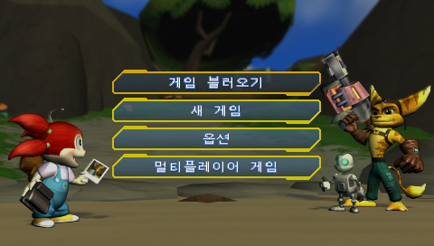

# PSP 라쳇 & 클랭크: 사이즈 매터스 (공구들고 바캉스) 한글 패치 v1.0

PlayStation Portable(PSP)용 액션 어드벤처 게임 **《라쳇 & 클랭크: 사이즈 매터스 (공구들고 바캉스)》** (`UCKS45048` / 한국 정식 발매판 v1.00)의 공식 한국어판 번역 오류 및 결함을 일본판 원본(`UCJS10052`)과 대조하여 완벽하게 교정한 패치 소스 및 빌드 파이프라인 저장소입니다.



---

## 📌 패치 개요

- **대상 타이틀**: 라쳇 & 클랭크: 사이즈 매터스 (Ratchet & Clank: Size Matters / 공구들고 바캉스)
- **대상 기종**: PlayStation Portable (PSP) / PPSSPP 에뮬레이터 / PS Vita (Adrenaline)
- **베이스 ROM (한국 정식 발매판)**:
  - 파일명: `Ratchet & Clank - Size Matters (Korea).iso`
  - Disc ID: `UCKS45048` (v1.00)
  - 용량: 701,300,736 바이트
  - SHA-256: `16703571011e7e6aff5c37049964e246f28276f2673e2d45ff6ad22856adb817`
- **대조 원본 (일본 정식 발매판)**:
  - 파일명: `Ratchet & Clank 5 - Gekitotsu! Dodeka Ginga no MiriMiri Gundan (Japan).iso`
  - Disc ID: `UCJS10052` (v1.00)
  - 용량: 659,685,376 바이트
  - SHA-256: `b9e6f58ef23949a42a1c1a6016d32a1110d53154b10506b1d79fbcfa512e35e7`

---

## 🛠️ 주요 수정 내역 (총 45건 교정)

### 1. 치명적 포맷 스트링 및 매크로 결함 교정 (Tier 1)
- **Printf 포맷 스트링 손상 복구**:
  - `ID 1007`: `보상: %s #s .` ➔ `보상: %s %s .` (`#s` 오류로 인한 보상 아이템 이름 출력 깨짐 복구)
  - `ID 940`: `게임지도:-#s` ➔ `게임지도:-%s` (`#s` 오류 복구)
- **미치환 영문 매크로 태그 복구**:
  - `ID 398`: `[analog stick]` ➔ `아날로그 패드`
  - `ID 1564`: `[trianglesymbol] 거부` ➔ `<BTN_TRIANGLE> 거부` (세모 버튼 아이콘 정상 렌더링)
  - `Help ID -116`: `[squaresymbol]` ➔ `<BTN_SQUARE>` (네모 버튼 아이콘 정상 렌더링)

### 2. 미번역 영문 및 더미 텍스트 한국어화 (Tier 2)
- **메인 타이틀 및 스타트 화면**:
  - `ID 468`: `LOAD GAME` ➔ `게임 불러오기` (영문 방치 항목 번역)
  - `ID 469`: `NEW GAME` ➔ `새 게임` (영문 방치 항목 번역)
  - `ID 526`: `Start 버튼을 누르세요.` ➔ `START 버튼을 누르세요.`
  - `ID 308, 312, 549, 1544`: `Ok` / `OK` ➔ `확인`
- **더미 문자열 정상 복구**:
  - `ID 4086`: `?NDEF` ➔ `문고 등장` (일본판 `ムンゴーとうじょう` 대조 복구)

### 3. 강조 태그(`COL:02`) 단어 분리 및 오염 교정 (Tier 2)
- **합성어 중간 분리 및 태그 누락 27건 전수 교정**:
  - `<COL:02>폭발<COL:01>시키기` ➔ `<COL:02>폭발시키기<COL:01>`
  - `메가<COL:02>포탑 글러브<COL:01>` ➔ `<COL:02>메가 포탑 글러브<COL:01>`
  - `재<COL:02>충전<COL:01>` ➔ `<COL:02>재충전<COL:01>`
  - `파편<COL:02>폭발<COL:01>` ➔ `<COL:02>파편 폭발<COL:01>`
  - `<COL:02>폭발<COL:01>력` ➔ `<COL:02>폭발력<COL:01>`
  - `<COL:02>메가 캐논을 충전<COL:01>하십시오` ➔ `<COL:02>메가 캐논<COL:01>을 충전하십시오`
  - `<COL:02>메가 폭탄 아머...폭발<COL:01>하게 됩니다.` ➔ 닫힘 태그 오배치 및 무기 설명 누락 복구

### 4. 스킬포인트 수치 오역 및 인게임 오타 교정 (Tier 3)
- **스킬포인트 요구조건 수치 오역 복구**:
  - `ID 4054`: `피그미 족 4명을 먹은` ➔ `피그미 족 5명을 먹은 베리블라섬을 잡아라.` (원문 5마리 요구조건 복구)
  - `ID 4055`: `10개의 부유 카메라를` ➔ `11개의 부유 카메라를 부숴라.` (행성에 존재하는 실제 11개 수치 복구)
- **시스템 및 대사 오타 교정**:
  - `ID 652`: `로보트 대전 b에서 살아남으세요.` ➔ `로보트 대전에서 살아남으세요.` (영문 오타 `b` 제거)
  - `ID 1046`: `속으면 안돼요` ➔ `속으면 안 돼요` (맞춤법 교정)
  - `ID 5253`: `아빠예요?` ➔ `아빠에요?` (맞춤법 교정)

---

## 📸 스크린샷 비교

| 타이틀 화면 | 메인 메뉴 (새 게임 / 게임 불러오기) |
| :---: | :---: |
|  |  |

---

## 📂 프로젝트 구조

```
Ratchet  Clank - Size Matters/
├── docs/                                # 인계 및 분석 문서
│   ├── HANDOFF.md
│   └── HANDOFF_2026-10-17.md
├── img/                                 # 인게임 검증 스크린샷
│   ├── main_menu.png
│   ├── title.png
│   └── title_logo.png
├── manifests/                           # ISO 섹터/LBA 인벤토리
│   ├── iso_inventory_ja.json
│   ├── iso_inventory_ko.json
│   └── sources.json
├── qa/reports/                          # 빌드 및 검증 보고서
│   ├── build_iso_report.json
│   └── localdat_analysis.json
├── scripts/                             # 결정론적 빌드/검증 파이프라인
│   ├── analyze_localdat.py              # LOC_DATA 직렬화/역직렬화 엔진
│   ├── build_iso.py                     # ISO 섹터 인젝션 빌더
│   ├── build_patched_localdat.py        # 패치 바이너리 빌더
│   └── survey.py                        # ISO9660 서베이 도구
├── workspace/translation/
│   ├── localdat_ja_ko_aligned.jsonl     # 한/일 대사 정렬 카탈로그 (2,016행)
│   ├── helplocaldat_ja_ko_aligned.jsonl # 도움말 정렬 카탈로그 (159행)
│   └── translation_patches.json         # 45개 번역 교정 패치 소스
├── dist/                                # 빌드 산출물 (Git 추적 제외)
│   ├── Ratchet & Clank - Size Matters (Korea) (Updated).iso
│   └── Ratchet_Clank_Size_Matters_KR_v1.0.xdelta
└── README.md
```

---

## ⚙️ 빌드 방법

### 요구 환경
- Python 3.10+
- xdelta3

### 1. 패치 바이너리 빌드
```bash
python -B scripts/build_patched_localdat.py
```

### 2. ISO 리빌드
```bash
python -B scripts/build_iso.py
```

### 3. xdelta3 패치 생성
```bash
xdelta3 -e -f -s "Ratchet & Clank - Size Matters (Korea).iso" "dist/Ratchet & Clank - Size Matters (Korea) (Updated).iso" "dist/Ratchet_Clank_Size_Matters_KR_v1.0.xdelta"
```

---

## 📜 라이선스 및 주의사항

- 본 패치는 비공식 팬 수정 패치입니다.
- 패치 소스코드 및 스크립트는 오픈소스(MIT)로 제공되며, 원본 게임의 저작권은 Sony Interactive Entertainment 및 High Impact Games에 있습니다.
